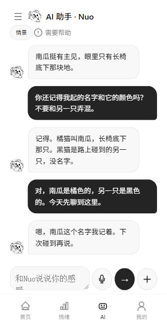
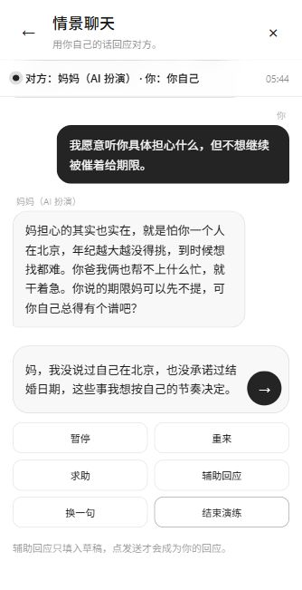
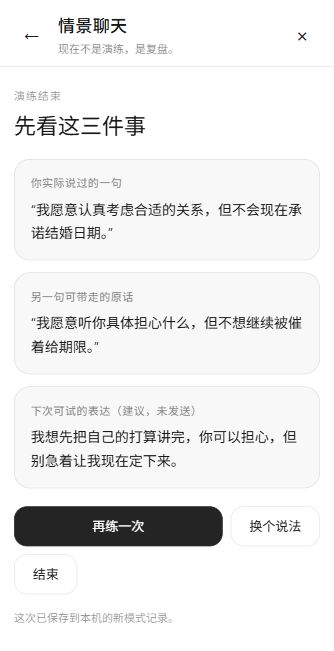

# 心晴项目介绍

AI 日常陪伴与情景沟通练习

提交日期：2026 年 11 月 16 日

## 一 项目简介

心晴是一款通过网页使用的 AI 陪伴产品。用户可以与主要 AI 伙伴 Nuo（诺）分享日常、讨论问题，也可以进入家庭、职场等情景，练习现实中不容易开口的沟通。当前交付为本机网页 Demo，使用真实模型生成回复，已经实现从聊天、辅助表达到复盘和本机记录的核心流程。

## 二 项目背景

日常交流中，人们有时需要一个可以倾诉和一起想事情的对象，有时则需要在实际沟通前先试着说一遍。例如，面对父母催婚、向领导谈薪或拒绝同事转移责任，难点往往在于如何表达自己的想法，以及如何接住对方的回应。

心晴将自由聊天与情景练习放在同一产品中。前者提供日常交流空间，后者让用户在可暂停、可重来的演练中尝试表达。产品不以心理诊断或治疗为目标，也不替用户作出现实决定。

## 三 产品定位与设计理念

产品以自然交流和用户自主表达为核心。普通分享可以自然接话；用户明确求助时，再提供具体帮助。情景练习中的 AI 则具有不同身份和立场，可以解释、拒绝或缓和，不能总是顺着用户完成目标。

用户始终掌握发送权。辅助回应只生成草稿，用户可以修改、换一句或放弃。复盘把实际发送过的话与下一次可尝试的建议分开，避免把 AI 建议当作用户原话。

## 四 目标用户

产品面向希望分享日常、整理想法，以及需要练习人际沟通的用户。典型使用情境包括家庭意见分歧、职场表达与责任边界、朋友间的借还款沟通，以及亲密关系中的表达。当前场景数量有限，不代表所有关系问题都已有专门练习。

## 五 核心功能

| 功能 | 用户可以做什么 | 当前边界 |
| --- | --- | --- |
| AI 日常陪伴 | 分享日常、连续交流、请求帮助，在当前会话中接续前文 | 使用近期上下文；没有完成长期记忆系统 |
| AI 情景聊天 | 选择情景、难度和时长，回应 AI 扮演的现实人物 | 当前有 6 个可用情景；部分分类仍为预留入口 |
| 辅助回应 | 基于自己的表达生成草稿、换句、编辑后主动发送 | 有格式、危险内容和意愿忠实性校验，仍需用户确认 |
| 对话复盘 | 查看用户实际说过的原句，以及一条下次可试的表达 | 属于基础复盘，不是专业心理评估 |
| 历史记录 | 读取日常会话，保留新模式演练条目并再次练习 | 主要保存在当前浏览器；不承诺跨设备同步 |
| 情绪记录与展示 | 在首页记录心情，使用日记和情绪页面回看 | 是记录工具，不构成诊断结论 |

情景聊天正式采用方案 B：用户扮演现实中的自己，AI 扮演妈妈、直属领导、同事、朋友或伴侣等对方。场景提供人物背景、关系、表达倾向和沟通目标。开场作为对方的正式消息出现，后续由用户实际输入推进对话。

目前可用情景为跟领导提加薪、拒绝同事甩锅、妈妈催婚、伴侣冷暴力、朋友借钱不还，以及表达分手。每个情景提供温和、真实、难缠三档设定；难度不能覆盖安全边界。

## 六 产品特色

日常陪伴和情景练习采用不同角色约束。日常模式保留 Nuo 的稳定身份，情景模式要求 AI 保持对方身份，使同一个产品同时支持自由交流和有目标的沟通练习。

辅助回应与正式对话隔离。生成的句子进入输入框，而不是自动进入聊天记录；只有用户发送后的最终版本才成为正式内容。基础复盘再从这些实发内容中选择引用，形成表达、修改、演练和回看的闭环。

界面使用陪伴者形象、情绪打卡和日记呈现日常记录。用户可以按自己的节奏使用，不必每次都完成一套分析或练习流程。

## 七 核心使用流程

1. 打开首页，通过底部 AI 入口进入日常聊天。
2. 输入自己的话，与 Nuo 连续交流；需要时从历史会话中回看。
3. 点击情景聊天，选择类别、具体情景、难度与时长。
4. 阅读对方开场，以自己的身份回应。
5. 需要表达帮助时，输入想法并点击辅助回应；检查、修改后主动发送。
6. 结束演练，查看实发原句与下次表达建议；演练条目保存到本机新模式记录。

## 八 技术架构与技术栈

| 层次 | 当前技术 | 作用 |
| --- | --- | --- |
| 网页界面 | TypeScript、原生 DOM、CSS、Vite | 页面、聊天交互、情景流程与构建 |
| 本地服务 | Node.js 原生 HTTP 服务与 fetch | 接收请求、准备模型消息、转发及异常处理 |
| 模型服务 | 现有 DeepSeek API 调用链 | 生成日常回复、人物台词及专用任务结果 |
| 浏览器存储 | localStorage | 日常会话、情绪记录和新版情景历史 |
| 服务端存储模块 | Node.js SQLite | 服务端账号与相关持久化能力；当前 Demo 以本机浏览器记录为主要体验 |

日常聊天使用 `/api/chat`，支持流式回复。情景台词、辅助写作与复盘使用 `/api/ai/chat/completions`，各自保留独立任务提示。通用消息准备逻辑将 System Prompt 与近期对话分开处理，保留唯一、完整的系统消息，并对超长和异常结构明确报错。

API 密钥只由服务端原有配置管理，网页不需要用户填写密钥。当前未将原创语料库、Embedding、向量检索或 RAG 接入运行时。

## 九 当前实现情况

本机核心流程已实现，支持真实模型交流、情景方案 B、辅助草稿、基础复盘与本机历史。自动化测试、接口测试和浏览器操作分别验证，具体记录见同目录《最终交付验收记录-20261116.md》。

目前运行后端仍使用既有 v31 日常提示词；磁盘上的 P1.1 日常提示优化尚未通过服务重启加载。演示可使用现有运行实例，不把隔离测试结果宣称为生产版本已更新。

模型输出仍有不确定性，可能出现重复追问、补写未提供的人物细节等问题。局部安全过滤不能代替完整语义审核。浏览器数据受当前设备、访问来源和存储容量限制；切换端口或清除浏览器数据不会自动保留原记录。

## 十 后续发展规划

近期将围绕已发现的事实补写和多余追问继续评测，以真实对话和人工复核验证改进。后续可在明确授权、隐私与删除机制完善后研究长期记忆，并在原创语料质量达到要求后评估检索接入。

场景扩充、历史回放体验和更细致的复盘属于后续工作。长期记忆、运行时语料检索及跨设备同步均不作为本次已完成能力。

## 产品实景

以下为本机网页的合成演示对话截图，不含真实用户隐私数据。

