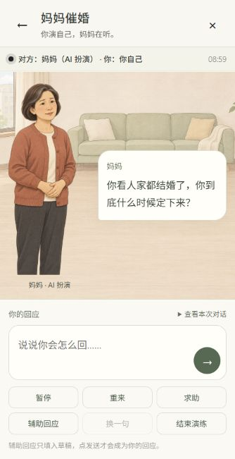

# 情景聊天家庭样板 UI V2 验收

日期：2026 年 11 月 16 日。范围：仅 `family-marriage` 妈妈催婚的前端展示，不批量改造其他类别。

## 交付结果

访问 <http://127.0.0.1:5174/>，AI → 情景 → 家庭 → 催婚 → 妈妈催婚 → 开始演练。验收结束时浏览器已留在新开的家庭样板。

主界面是家庭客厅背景、单个人物立绘和最新一段妈妈台词。没有用户侧立绘或用户聊天气泡。用户实发内容保留在完整 messages 中，仍参与模型上下文、辅助任务、复盘和 v2 历史；“查看本次对话”以按需展开的文本记录展示。



## 实际场景与素材检查

项目八大类为家庭、职场、亲密关系、朋友、自我、消费、照护、数字。目前有 6 张可用卡：谈薪的直属领导、甩锅的同事、催婚的妈妈、冷战的伴侣、借款的朋友、分手的伴侣。其余许多子类是预留入口，并没有完整可运行场景。

已有图片主要是猫、狗等陪伴者形象及日记纸张，不能替代现实人物。本次新增同一柔和插画方向的客厅背景和妈妈立绘，按具体场景 ID 映射。其他卡返回空映射并继续使用原展示；没有把妈妈设为家庭全类或八大类的默认人物。

## 修改文件

| 文件 | 修改内容 |
| --- | --- |
| `web/features/scenario/index.ts` | `renderRoleplay` 接入家庭样板；复用原输入、辅助、求助、取消及结束事件；发送即清空，失败恢复原草稿；保留完整实发 messages。入口在第 588 行，草稿处理在第 746 行。 |
| `web/features/scenario/scenario.css` | 第 812 行起为家庭专属样式；上下分区、人物与气泡分列、底部输入、长台词滚动、180 ms 轻淡入及减少动画偏好。其他卡不套用这些样式。 |
| `web/features/scenario/presentation.ts`（新增） | `visualFor` 场景级映射、`portraitFor` 表情资源回退、`latestCounterpartLine` 展示投影、`createCharacterStage` 单侧气泡、`createTranscriptViewer` 按需文本记录。 |
| `web/features/scenario/presentation.test.mjs`（新增） | 4 项测试：映射隔离、实际素材与表情回退、五轮历史不丢失、长台词不截断。 |
| `package.json` | 仅将上述测试追加到原 npm test 命令，没有删除测试或新增依赖。 |
| `public/scenario/family-marriage/mother-neutral-v1.png`（新增） | 妈妈立绘，1024 × 1536，RGBA，含真实透明通道。 |
| `public/scenario/family-marriage/living-room-v1.png`（新增） | 家庭客厅背景，1536 × 1024。 |

附加产物为本记录、`screenshots/family-ui-v2/` 下的截图及 npm 构建自动生成的 dist。没有手工修改构建产物。

浏览器初查发现样板样式被接到了设置页，已移回正式演练页并重新验收。最终设置页、列表页、复盘页仍采用原展示。

## 交互与数据保护

- 主气泡只读取最新 `assistant`。发送 user 后保留上一段对方台词并显示等待状态，新 assistant 成功后替换台词。
- 输入经过原有长度、设定和风险检查。正常发送后马上清空；生成失败恢复发送前的原草稿，并沿用原错误状态和重试方式。
- 辅助回应继续复用原 `generateAssist`、忠实性核验和草稿版本保护。未发送的建议不写入 messages，不产生对方回复。
- 最新回复变化时才添加轻淡入，不因为点辅助、换句或重新绘制就把旧台词当成新回复。
- 使用 textContent 和文本节点展示模型及历史内容；没有把台词作为 HTML 注入。
- `CharacterExpression` 预留 neutral、concerned、softened。当前只有中性立绘，缺少其他表情时回退同一人物中性图；没有实现情绪识别或自动表情切换。

## 实际测试结果

### 自动化与构建

| 命令 | 实际结果 |
| --- | --- |
| `node --test web/features/scenario/presentation.test.mjs` | 4/4 通过 |
| `npm test` | 160/160 通过；fail、cancelled、skipped 均为 0；988.427 ms |
| `npm run build` | tsc 与 Vite 成功；84 个模块；Vite 608 ms |

原 P0 的 System 保留、角色、辅助忠实性、历史 v1/v2 隔离、安全过滤和 API 错误等测试均继续保留。自动化结果不代替以下浏览器验收。

### 真实服务与浏览器

使用现有 5174 前端、3001 后端及原真实模型链路，只输入合成演练内容。

| 项目 | 实际结果 |
| --- | --- |
| 单侧视觉 | 1 个妈妈立绘、1 个当前气泡、0 个用户气泡 |
| 生活背景与脸部 | 实际显示客厅；人物与气泡在不同列，边界不重叠，没有遮住脸 |
| 底部输入 | 发送时立即清空，等待时为空，完成后可继续输入；当前视口输入区可见 |
| 连续 5 轮 | 五次发送均收到妈妈角色真实回应，没有角色反转 |
| 上下文 | 第 5 轮问没有承诺什么，回答“你没答应结婚日期，这个妈听清楚了……” |
| 完整历史 | 第 5 轮后 DOM 中本次文本记录为 11 条，其中用户 5 条；展示投影没有删除历史 |
| 辅助与换句 | 两次真实生成成功；生成及换句后，主气泡和正式记录保持原状态 |
| 编辑与主动发送 | 修改后第 4 句才加入正式记录；未发送版本不在展开记录中 |
| 求助 | 显示原有提示“先听清对方在要什么，再说你的结论……” |
| 复盘 | 引用第 4 句编辑后的最终实发版本及第 5 句；没有引用对方台词或辅助旧草稿 |
| 保存与刷新 | 显示保存成功；刷新后新“妈妈催婚”条目仍在，旧条目仍可见 |
| 控制台 | 实际页面本轮采样的 warn/error 为 0 条；不是以此代替真实生成检查 |

第 4 句实发：`妈，我想按自己的节奏决定，结婚日期现在不承诺，也请你先听完我的想法。`

第 5 句实发：`先确认一下，我刚才明确没有承诺的是什么？请别把我的话当成已经答应了。`

### 隔离浏览器异常检查

另用项目已有 `preview-p021.mjs`，独立端口 61901、临时数据库、固定模拟上游，未调用真实模型。以下仅为受控浏览器验证：

| 样本 | 实际结果 |
| --- | --- |
| `检查请求失败：这段输入必须保留。` | 模拟上游失败；恢复相同输入，显示原错误提示，未把错误当人物台词 |
| 正常表达 | “材料齐了，我才能替你说话。”出现在妈妈气泡中，没有误拦 |
| 正常拒绝 | “我现在没法答应，需要先看预算。”可显示 |
| 受控威胁输出 | 触发安全页面，危险正文没有展示为台词，也没有加入 assistant 历史 |

隔离页已关闭，隔离测试服务已退出。模拟结果没有计入五轮真实对话。

## 原系统与运行环境核验

本轮前后 SHA-256 比较一致的文件包括：

- `web/features/scenario/dialogue.ts`：EBF65CC72E93AC92140BE4206B9DF2F833E90A2B10ECAF05F2E7D0B13305A0D0
- `web/features/scenario/scenarios.ts`：FE3FDE615E67EB05371186F95BEED6F7C710EEA97EC626AB7A6C3CF88167A578
- `web/features/scenario/assist.ts`：5A66CCCAE35A127B5C8EBEE3E2D00E5A1B459BBA808AA564CCA27066C7DBCF82
- `web/features/scenario/history.mjs`：F26ECE73114947D580B42D2EEE4D6699058847BEE8D572C7519C2DF099635C03
- `web/kernel/api.ts`：00D7D39E03C4E1E50F7188F1BA4AF015977835A581C8A49F66B5179C9AAFA927
- `account-service/server.mjs`：3DFA6000E30A1376AF1EF9DB87DC45D02A1931EDB97DA88B49F9750BCFF48EAD

因此，本轮没有修改现有 AI 提示词、模型调用、辅助规则、历史格式或后端。没有读取或修改 .env/密钥，没有修改 Schema、语料库，没有执行 Git 操作，没有删除旧历史。

最终只读检查：3001 仍由 PID 43788 监听，父进程 50392，启动时间仍为 2026-11-16 00:31:48.292117 +08:00；健康接口正常，运行日常提示版本仍为 v31。没有停止或重启该服务。本次 UI 使用前端热更新，无需后端重启。

## 已知边界与待负责人验收

1. 只完成妈妈催婚。爸爸、其他现实人物、其他类别尚未制作相应立绘或背景。
2. 当前只有一个自然中性表情；扩展接口已经提供，自动表情变化尚未实现。
3. 已检查当前 Windows 浏览器视口；尚未专测真手机软键盘和全部屏幕尺寸。
4. 原有模型仍可能补写背景或产生不理想台词，本次没有修改提示词或声称解决全部对话质量问题。
5. 风格是否符合“简洁、自然、生活化”的最终产品判断，等待负责人浏览器审核；未继续批量改造其他类别。

## 素材生成记录

使用内置 imagegen；没有使用 CLI、读取图像服务密钥或安装依赖。最终素材已复制到项目 public 目录，原始生成文件保留。提示如下。

### 妈妈立绘

```text
Use case: illustration-story. Asset type: transparent character portrait for a Chinese everyday interpersonal practice web app, NOT a game. Create one Chinese mother around middle age, natural mature proportions, simple chestnut short bob with a few gray strands, softly concerned attentive expression, wearing a muted warm terracotta cardigan over a cream shirt and plain charcoal trousers. Gentle hand-drawn editorial cartoon illustration with fine dark brown pencil outlines, flat subdued warm color areas and very subtle paper texture. Friendly but not babyish, no anime or glossy 3D or exaggerated eyes. Single person only, front three-quarter view facing slightly toward the viewer's right, standing quietly, both hands visible and naturally resting together at waist, framed from head to just below knees. Entire head and hands visible with ample clear margin around silhouette. No furniture, no text, no speech bubbles, no labels, no props, no shadows outside the silhouette, no border. Genuinely transparent background with clean alpha; do not draw a checkered pattern. This will sit in the left column beside a separate UI speech bubble; make the face unobstructed.
```

### 家庭背景

```text
Use case: illustration-story. Asset type: quiet background plate for a Chinese everyday interpersonal practice web app, NOT a game. A simple contemporary family living room, no people: soft off-white wall, a low muted sage green sofa along the back wall, small wooden side table with a tea cup, one pale curtain and a broad window suggesting daylight, a modest leafy plant off to the side. Unified gentle editorial cartoon illustration: fine warm gray-brown pencil outlines, flat muted color areas, light paper texture, natural everyday proportions, low saturation warm cream, sage and pale wood palette. Wide landscape composition about 3:2. Large calm empty foreground in the lower two thirds for a separate standing mother character and UI speech bubble; keep decorative detail sparse, background low contrast and secondary. A little lived-in warmth without holiday decorations, no calligraphy or wall text, no people, no pets, no UI, no bubbles, no watermark, no logo, no fantasy or anime or game scene.
```
